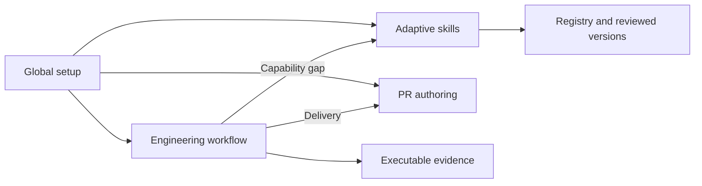

# Engineering Infrastructure

[简体中文](README.zh-CN.md)

Three portable Kits give coding agents a common engineering workflow, evidence tools, a skills lifecycle, and pull request guidance. The bootstrap installs the three CORE Skills and a short user-level instruction block. Domain skills stay on demand.



## Quick start

Use a trusted checkout and native Python 3.9 or later. Run once per user environment, including from inside WSL. Select the agents you use.

```sh
python tools/setup.py plan --agents codex claude opencode antigravity
python tools/setup.py apply --agents codex claude opencode antigravity
python tools/setup.py verify
```

Open a fresh agent session in a project and check the three CORE Skills. See [BOOTSTRAP](BOOTSTRAP.md) for discovery paths, state location, migration, and rollback. See [OPTIMIZE](OPTIMIZE.md) for drift checks, updates, retirement, and feedback.

| Kit | Role |
| --- | --- |
| [Engineering Workflow](engineering-workflow-kit/README.md) | Risk routing, evidence capture, regression verification and implementation review |
| [Adaptive Skills](adaptive-skills-kit/README.md) | Inventory, local-first capability resolution, controlled acquisition, activation and retirement |
| [PR Authoring](pr-authoring-kit/README.md) | Upstream-aware PR composition and body lint |

[Skills reference](adaptive-skills-kit/skills%20reference.md) is generated from the registry and bundled locks. Machine plans, receipts, private inventory, and rollback data live outside the repository. Project-level instructions and build processes continue to apply.

## Verification

```sh
python -I -B -W error::ResourceWarning -m unittest discover -s engineering-workflow-kit/tests
python -I -B -W error::ResourceWarning -m unittest discover -s adaptive-skills-kit/tests
python -B tools/setup.py sync-reference --check
```

CI runs offline checks on Ubuntu and Windows. Filesystem verification and agent discovery are separate checks. Review the [vNext verification record](engineering-workflow-kit/reports/vnext.md) for concrete evidence and platform limits.

The workflow draws from [Lauren Tan's engineering talk](https://ai.engineer/code/2026/talks/lauren-tan), [OpenAI's harness engineering](https://openai.com/index/harness-engineering/), and the [Agent Skills specification](https://agentskills.io/specification).

[Contributing](CONTRIBUTING.md) · [Changelog](CHANGELOG.md) · [Apache-2.0](LICENSE)
