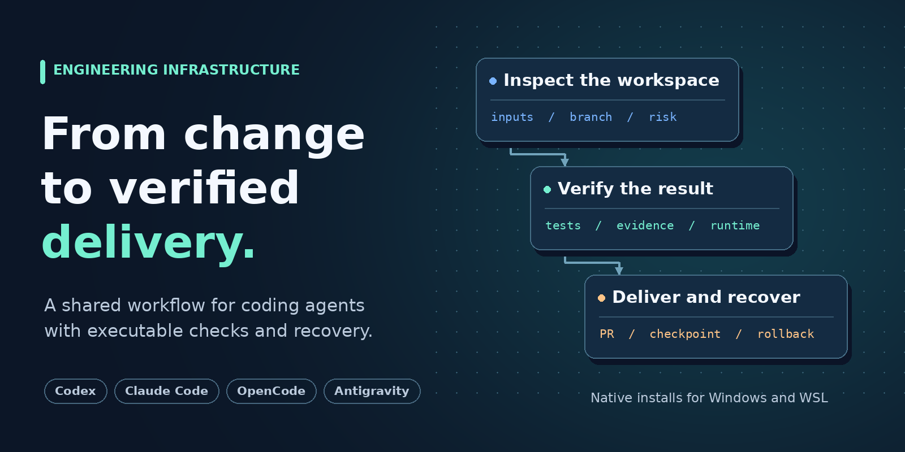
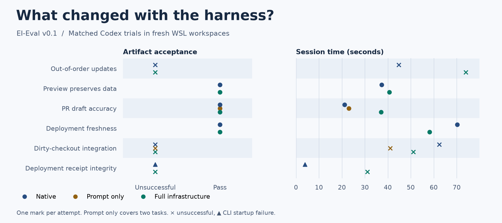

# Engineering-Infrastructure

[简体中文](README.zh-CN.md)

**Give your coding agents a shared path from a code change to verified delivery.**



Install once per user environment. Codex, Claude Code, OpenCode, and Antigravity can use the same three Kits through native discovery paths. Each repository keeps its own rules, tests, and deployment commands.

[Quick start](#quick-start) · [How it works](#how-it-works) · [Measured results](#measured-results) · [Operational evidence](engineering-workflow-kit/reports/operational.md)

## When the branch is green but the deployment is stale

An upstream ref moves while a feature is still in progress. Engineering Workflow can preserve the active checkout, build the selected inputs in an isolated worktree, and verify what is actually installed. If the installation fails, the deployment transaction can recover the prior verified release. At handoff, the PR draft can cite the checks that actually ran.

## How it works

| Kit | What it gives your agent |
| --- | --- |
| [Engineering Workflow](engineering-workflow-kit/README.md) | Risk-based workflow, checks tied to source state, isolated integration, runtime freshness probes, and recovery. |
| [Adaptive Skills](adaptive-skills-kit/README.md) | Find installed capabilities first, consult a pinned catalog when a gap remains, and stage approved versions for review. |
| [PR Authoring](pr-authoring-kit/README.md) | Turn the change and its evidence into a reviewable PR that respects upstream policy. |

The bootstrap adds a short user-level entry point. Domain Skills load on demand, and machine-specific plans, inventories, and recovery data stay local. See the [project lifecycle](engineering-workflow-kit/engineering-workflow/references/lifecycle.md) and [Skills reference](adaptive-skills-kit/skills%20reference.md).

## Quick start

Use a trusted checkout and native Python 3.9 or later. Run once per user environment, including from inside WSL. Select the agents you use.

```sh
python tools/setup.py plan --agents codex claude opencode antigravity
python tools/setup.py apply --agents codex claude opencode antigravity
python tools/setup.py verify
```

Open a fresh agent session in a project and check the three CORE Skills. See [BOOTSTRAP](BOOTSTRAP.md) for discovery paths, state location, migration, and rollback. See [OPTIMIZE](OPTIMIZE.md) for drift checks, updates, retirement, and feedback.

## Measured results

**Eight lifecycle scenarios passed.** An existence check missed a changed deployment, and a clean Git status missed a moved input ref. Runtime verification detected both. The failed-install scenario recovered the previously verified release.

The six-task Codex pilot recorded **3/6 accepted artifacts for Native and 3/6 for Full**. Full took a median **9.7 seconds longer per pair**. The per-task results show where the additional workflow changed time and effort.



[Technical report](https://github.com/Koooki3/Engineering-Infrastructure/blob/main/evaluation/REPORT.md) · [Results and data](https://github.com/Koooki3/Engineering-Infrastructure/blob/main/evaluation/RESULTS.md) · [Reproduce the evaluation](https://github.com/Koooki3/Engineering-Infrastructure/tree/main/evaluation)

## Verification

```sh
python -I -B -W error::ResourceWarning -m unittest discover -s engineering-workflow-kit/tests
python -I -B -W error::ResourceWarning -m unittest discover -s adaptive-skills-kit/tests
python -B tools/setup.py sync-reference --check
```

CI runs offline checks on Ubuntu and Windows. Filesystem verification and agent discovery are separate checks. Review the [vNext verification record](engineering-workflow-kit/reports/vnext.md) for concrete evidence and platform limits.

The workflow draws from [Lauren Tan's engineering talk](https://ai.engineer/code/2026/talks/lauren-tan), [OpenAI's harness engineering](https://openai.com/index/harness-engineering/), and the [Agent Skills specification](https://agentskills.io/specification).

[Contributing](CONTRIBUTING.md) · [Changelog](CHANGELOG.md) · [Apache-2.0](LICENSE)
