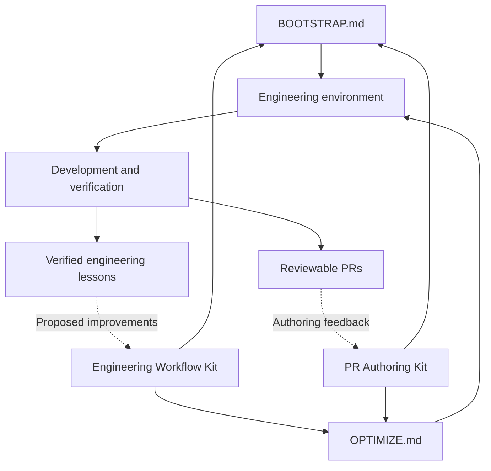
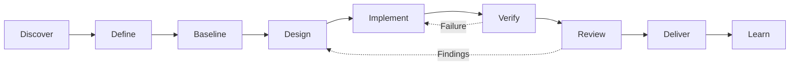

# Engineering Infrastructure

**Portable, agent-agnostic engineering workflows for building, verifying, and shipping software.**

[简体中文](README.zh-CN.md) · [Bootstrap](BOOTSTRAP.md) · [Optimize](OPTIMIZE.md) · [License](LICENSE)


Engineering Infrastructure is a reusable collection of agent-facing engineering protocols, skills, templates, and lightweight Python tooling. It helps coding agents establish a development environment, improve an existing one, and prepare reviewable pull requests without rebuilding the engineering process for every repository.

The goal is not more prompts or more automation. It is **better engineering outcomes through executable constraints, evidence-driven verification, risk-adaptive workflows, and continuous learning**.

## What is included?

| Component | Responsibility |
| --- | --- |
| [BOOTSTRAP.md](BOOTSTRAP.md) | Initialize, integrate, or migrate an engineering environment. |
| [OPTIMIZE.md](OPTIMIZE.md) | Audit, consolidate, simplify, and update an existing environment. |
| [Engineering Workflow Kit](engineering-workflow-kit/README.md) | Risk routing, implementation and verification workflows, evidence records, mechanical checks, and reversible skill deployment. |
| [PR Authoring Kit](pr-authoring-kit/pr-authoring/SKILL.md) | Adaptive, evidence-driven GitHub pull request authoring with English-first bilingual formatting where upstream permits. |



## Design principles

- **Harness over prompts.** Prefer architecture, APIs, tests, types, and executable checks over repeated instructions.
- **Evidence before claims.** Tie verification records to repository state and report failed, blocked, and unexecuted checks accurately.
- **Risk-adaptive execution.** Use the smallest workflow appropriate to the task; escalate when impact or uncertainty increases.
- **Progressive disclosure.** Keep entry points small and load specialized knowledge only when relevant.
- **Existing assets first.** Reuse effective local practices and remove unnecessary duplication instead of replacing everything.
- **Portability and reversibility.** Adapt to the actual agent, OS, repository, and user authorization; preserve existing work and configuration.
- **Continuous improvement.** Turn recurring failures into tested engineering constraints, and retire rules that no longer justify their cost.

## Quick start

### 1. Get the repository

```bash
git clone https://github.com/Koooki3/Engineering-Infrastructure.git
```

Repository access is required. Keep the source kits separate from machine-specific deployment state. Review local plans and scripts before executing them; do not reuse another machine's deployment or rollback state.

### 2. Select an entry point

| Situation | Protocol |
| --- | --- |
| New machine, new project, or new coding agent | [BOOTSTRAP.md](BOOTSTRAP.md) |
| Existing project adopting the kits for the first time | [BOOTSTRAP.md](BOOTSTRAP.md) |
| Existing environment with redundant or outdated rules | [OPTIMIZE.md](OPTIMIZE.md) |
| Kit upgrade or periodic engineering maintenance | [OPTIMIZE.md](OPTIMIZE.md) |

### 3. Give your coding agent the following instruction

```text
Read and execute the selected protocol in full.

Protocol: <absolute path to BOOTSTRAP.md or OPTIMIZE.md>
Engineering Workflow Kit: <absolute path to engineering-workflow-kit>
PR Authoring Kit: <absolute path to pr-authoring-kit>

Inspect the actual environment before making changes. Reuse existing
capabilities, respect repository policies and authorization boundaries,
and implement only justified changes. Validate the result and report
failures, limitations, and rollback instructions. Do not publish or push
anything without explicit authorization.
```

The agent should resolve the paths in the environment where it runs (including WSL if applicable), identify the supported skill discovery mechanism, and adapt the installation to the actual project. The protocols are currently primarily Chinese; the agent must be able to interpret their contents.

To install the workflow skill and its instruction blocks on a machine, copy [`plan.example.json`](engineering-workflow-kit/deploy/plan.example.json) outside the repository, replace the `<ABS_PATH_TO>` and `<HOME>` placeholders with real absolute paths (a Bootstrap agent can do this for you), then run it with that environment's native Python:

```bash
python -I -B engineering-workflow-kit/tools/deploy.py apply  --plan ~/.ewk/plan.json --state ~/.ewk/deployments/state-1.json
python -I -B engineering-workflow-kit/tools/deploy.py verify --state ~/.ewk/deployments/state-1.json
python -I -B engineering-workflow-kit/tools/deploy.py rollback --state ~/.ewk/deployments/state-1.json
```

Keep the plan, state files and backups outside the repository (they are git-ignored if placed under it). Use a new `--state` file for every `apply`, and roll back in reverse order.

There is no universal one-command installer. The bootstrap protocol orchestrates integration; the workflow kit's deployment helper installs its own skill and marked instruction blocks from a machine-specific plan.

## Engineering Workflow Kit

The kit implements a minimal engineering loop:



| Risk tier | Typical work | Minimum approach |
| --- | --- | --- |
| Fast | Low-risk local changes | Targeted checks and concise delivery |
| Standard | Features, nontrivial fixes | Acceptance criteria, focused regression checks, and self-review |
| Critical | Architecture, concurrency, migrations, security, or release-sensitive changes | Explicit acceptance contract, deeper review, isolated verification, and rollback planning |

The standard-library Python helper `ewk.py` provides four commands:

| Command | Purpose |
| --- | --- |
| `run` | Execute a command with a timeout and record its outcome and repository state. |
| `check` | Check evidence consistency, freshness, and required results. |
| `guard` | Apply mechanical diff checks for protected paths, encoding, and selected secret patterns. |
| `route` | Suggest a risk tier from changed paths and explicit risk flags. |

Example, from the target repository (replace the placeholder paths and test command as needed):

```bash
python "<kit>/engineering-workflow/scripts/ewk.py" run --evidence "<local-state>/evidence.json" --id unit -- python -m unittest discover
python "<kit>/engineering-workflow/scripts/ewk.py" check --evidence "<local-state>/evidence.json" --require unit
python "<kit>/engineering-workflow/scripts/ewk.py" guard --worktree-only
```

Create the local evidence directory first and use a fresh evidence file for a new verification round. Evidence checking is not tamper-proof execution attestation; ignored files and external environment state are not fully represented by the Git fingerprint. The guard is a lightweight aid, not a replacement for dedicated secret scanning or security review.

See the [workflow kit documentation](engineering-workflow-kit/README.md) for deployment, verification, and rollback details.

## PR Authoring Kit

The PR skill separates implementation from communication. It adapts PR structure to the change and the upstream contribution policy:

- English title, with Conventional Commits-style syntax when appropriate.
- Complete English body and concise Simplified Chinese summary when permitted.
- Screenshots, recordings, diagrams, tables, and other visual evidence in the English body only.
- Actual test results, benchmark methodology, compatibility risks, and reviewer notes as applicable.
- No fabricated evidence, unauthorized publishing, or overrides of upstream templates and AI contribution policies.

Start with the [PR skill](pr-authoring-kit/pr-authoring/SKILL.md), [template](pr-authoring-kit/pr-authoring/pull_request_template.md), and [example](pr-authoring-kit/pr-authoring/example.md).

## Repository structure

```text
Engineering-Infrastructure/
├── .github/workflows/ci.yml    # Unit tests on Ubuntu and Windows
├── BOOTSTRAP.md
├── OPTIMIZE.md
├── engineering-workflow-kit/
│   ├── engineering-workflow/   # Deployable skill, references, templates, helper
│   ├── tools/                  # Deployment helper
│   ├── deploy/                 # plan.example.json and instruction blocks
│   ├── tests/                  # Workflow and deployment tests
│   └── reports/                # Sanitized validation and engineering records
├── pr-authoring-kit/
│   └── pr-authoring/           # Deployable PR skill, template, example, body lint
└── LICENSE
```

Only portable source assets should be distributed. Machine-specific plans, deployment backups, and raw local evidence belong outside the version-controlled distribution.

## Validation and compatibility

The original v1.0.0 validation recorded 56 passing offline tests. After the hardening pass, all 62 offline tests passed locally on Windows (Python 3.12) and WSL Ubuntu (Python 3.14); CI runs them on Ubuntu and Windows (see `.github/workflows/ci.yml`). These are results from specific environments, not a guarantee for every installation.

| Environment | Recorded status |
| --- | --- |
| Claude Code on Windows | Installed; skill discovery observed |
| Claude Code on WSL | Installed and verified; headless trigger test blocked |
| Codex on Windows / WSL | Files deployed; actual discovery and invocation not verified |
| Other agents / operating systems | Adaptation required; not validated |
| Python 3.9+ | Declared minimum; exercised by CI (see the latest Actions run) |

To run the workflow kit's offline tests:

```bash
cd engineering-workflow-kit
python -I -B -W error::ResourceWarning -m unittest discover -s tests
```

No controlled task-level study has yet established improvements in completion rate, defects, elapsed time, or token consumption. See the [kit README](engineering-workflow-kit/README.md) for recorded limitations.

## Inspirations

The project draws on engineering ideas from [Lauren Tan — All Code Is Slop (Except Mine)](https://ai.engineer/code/2026/talks/lauren-tan), [OpenAI — Harness Engineering](https://openai.com/index/harness-engineering/), [Anthropic — Building Effective Agents](https://www.anthropic.com/engineering/building-effective-agents), and [Google Engineering Practices](https://google.github.io/eng-practices/). The protocols are project-defined conventions, not an official industry standard or an endorsed implementation by those organizations.

## Contributing

Keep changes focused and justify new mechanisms with concrete engineering problems. Prefer executable regression tests to additional prose where possible. Separate portable improvements from private project data and machine-specific state. Report what was actually verified and what remains uncertain.

## License

[Apache License 2.0](LICENSE).
