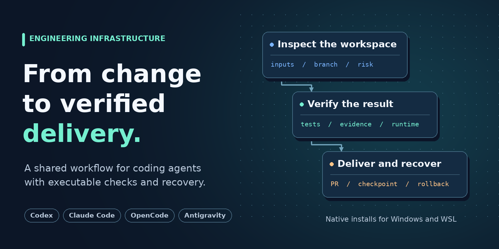

# Engineering-Infrastructure

[English](README.md)

**给编码 Agent 一套从代码修改走到可验证交付的共同工作流。**



每个用户环境安装一次，Codex、Claude Code、OpenCode 和 Antigravity 就能通过各自的原生路径发现三套 Kit。项目继续使用自己的约定、测试和部署命令。

[快速开始](#快速开始) · [三套 Kit 如何协作](#三套-kit-如何协作) · [实测结果](#实测结果) · [实机验收](engineering-workflow-kit/reports/operational.md)

## 分支看起来正常，运行版本却落后了

上游引用更新时，当前分支可能还有工作没做完。工程工作流可以保留现场，在独立 Worktree 中集成选定的提交，再核对实际安装内容。若安装失败，部署事务可以恢复上一个验证通过的版本。到了交付环节，PR 草稿可以直接使用真实检查证据。

## 三套 Kit 如何协作

| Kit | 实际作用 |
| --- | --- |
| [Engineering Workflow](engineering-workflow-kit/README.md) | 按风险选择流程，把检查结果绑定到源码状态，并支持隔离集成、运行版本核对和恢复。 |
| [Adaptive Skills](adaptive-skills-kit/README.md) | 优先复用本机能力，遇到缺口时查阅版本锁定的目录，按授权隔离暂存和审核。 |
| [PR Authoring](pr-authoring-kit/README.md) | 根据上游规范把改动和验证证据整理成便于审查的 PR。 |

Bootstrap 写入简短的全局入口。领域 Skills 按需加载，部署状态、私人盘点和恢复记录保存在本机。参见[项目生命周期](engineering-workflow-kit/engineering-workflow/references/lifecycle.md)和 [Skills 参考目录](adaptive-skills-kit/skills%20reference.md)。

## 快速开始

使用已审查的仓库版本和原生 Python 3.9 或更新版本。在 Windows 和 WSL 各运行一次，只列出实际需要的 Agent。

```sh
python tools/setup.py plan --agents codex claude opencode antigravity
python tools/setup.py apply --agents codex claude opencode antigravity
python tools/setup.py verify
```

在没有项目级配置的目录开一个新会话，确认三项 CORE Skill 已被运行时发现。全局路径、历史部署迁移、回滚和新机器恢复见 [BOOTSTRAP](BOOTSTRAP.md)。盘点、更新、停用和反馈见 [OPTIMIZE](OPTIMIZE.md)。

## 实测结果

**八个生命周期场景全部通过。** 仅检查产物是否存在会漏掉安装内容漂移，仅检查 Git 工作树是否干净会漏掉输入引用变化。运行时检查识别了这两类问题，安装失败后也恢复了此前验证通过的版本。

六项 Codex 配对试验中，**原生组和完整组均通过 3/6**。完整组每对任务的耗时差中位数为 **+9.7 秒**。这轮小样本评测展示了哪些检查能补足工程验证，以及它们带来的额外开销。


[英文技术报告](https://github.com/Koooki3/Engineering-Infrastructure/blob/main/evaluation/REPORT.md) · [任务结果与数据](https://github.com/Koooki3/Engineering-Infrastructure/blob/main/evaluation/RESULTS.md) · [复现说明](https://github.com/Koooki3/Engineering-Infrastructure/tree/main/evaluation)

[验证命令](README.md#verification) · [本轮验证记录](engineering-workflow-kit/reports/vnext.md) · [图稿](docs/diagrams) · [变更记录](CHANGELOG.md) · [Apache-2.0](LICENSE)
