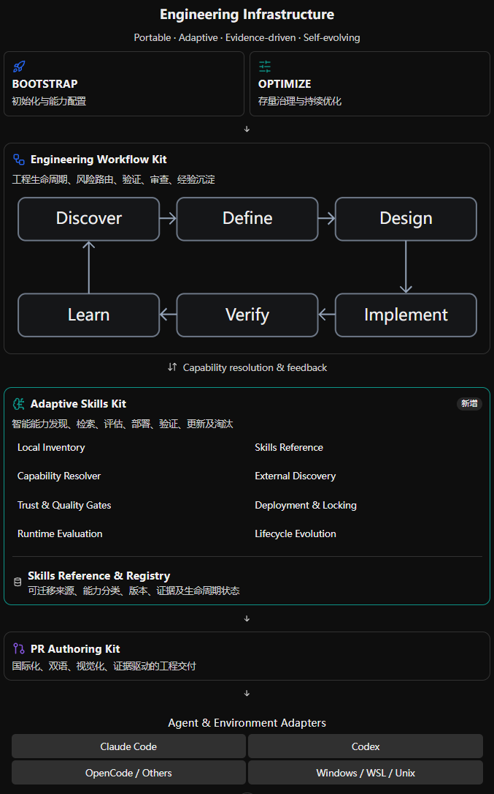

# Engineering Infrastructure

[English](README.md)

面向多个编码 Agent 的用户级工程基础设施，包含工程工作流、Adaptive Skills 生命周期和 PR 交付三个 Kit。Bootstrap 部署三项 CORE Skills 及简短的全局路由指令。各项目继续使用自身的约定、构建和验证入口，领域 Skill 按实际任务加载。



## 快速开始

使用已审查的仓库版本和原生 Python 3.9 或更新版本。在 Windows 和 WSL 各运行一次，只列出实际需要的 Agent。

```sh
python tools/setup.py plan --agents codex claude opencode antigravity
python tools/setup.py apply --agents codex claude opencode antigravity
python tools/setup.py verify
```

在没有项目级配置的目录开一个新会话，确认三项 CORE Skill 已被运行时发现。全局路径、历史部署迁移、回滚和新机器恢复见 [BOOTSTRAP](BOOTSTRAP.md)。盘点、更新、停用和反馈见 [OPTIMIZE](OPTIMIZE.md)。

| Kit | 职责 |
| --- | --- |
| [Engineering Workflow](engineering-workflow-kit/README.md) | 工程风险分层、可执行验证、证据绑定和交付复核 |
| [Adaptive Skills](adaptive-skills-kit/README.md) | 能力解析、本机盘点、按需发现及受控部署、升级和归档 |
| [PR Authoring](pr-authoring-kit/README.md) | 遵守上游政策的 PR 编写及正文校验 |

[Skills 参考目录](adaptive-skills-kit/skills%20reference.md) 由注册表和版本锁生成。部署状态、私人盘点、回滚备份和反馈留在机器本地。默认获取模式为 `REPORT_ONLY`，激活第三方能力需事先配置明确的范围和内容指纹授权。

[验证命令](README.md#verification) · [本轮验证记录](engineering-workflow-kit/reports/vnext.md) · [图稿](docs/diagrams) · [变更记录](CHANGELOG.md) · [Apache-2.0](LICENSE)
