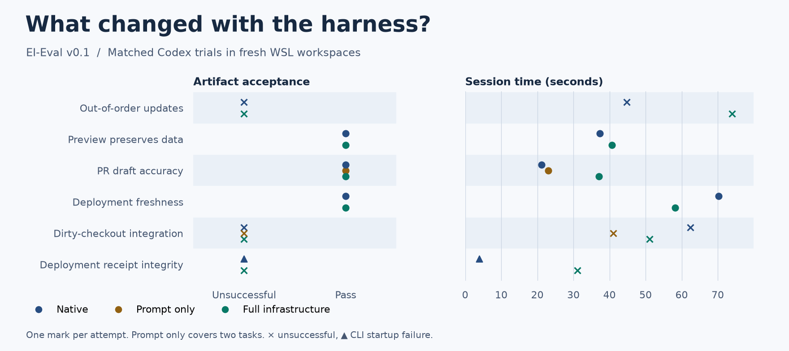

# Engineering-Infrastructure

## An empirical pilot of a portable engineering harness for coding agents

**Evaluation version** v0.1 · **Subject** `0f274aa` · **Owner** project maintainers

### Abstract

This report evaluates an engineering harness that installs a common workflow, a Skills lifecycle, and PR authoring on top of an existing coding agent. It separates agent task outcomes from deterministic checks of the tools themselves. The paired Codex pilot measures artifact acceptance and the cost of getting to that artifact. A separate lifecycle study measures concrete failure detection and recovery. Results describe the tested tasks and environment.

### System and research questions

The workflow binds tests to the repository state, separates integration work from an active checkout, and probes the deployed instance. Adaptive Skills first considers local capabilities and then the curated versioned catalog. PR Authoring turns concrete evidence into an upstream-aware review artifact. The global installer places the same three CORE Skills and a short routing instruction into native agent paths.

The pilot asks whether full versus native changes artifact acceptance (RQ1), how session time and usage change (RQ2), and what a tool-equipped workflow adds beyond written goals on a small subsample (RQ3). Evidence integrity, deployment, recovery, and capability resolution are assessed with targeted tool trials (RQ4–6). Multi-session handoff, longitudinal learning, transfer to a second agent, and broader task-level tradeoffs (RQ7–10) require additional trials.

### Related methods and benchmark selection

| Source | Design decision in this evaluation |
| --- | --- |
| [SkillsBench v1.1](https://www.skillsbench.ai/) and [paper v4](https://arxiv.org/abs/2602.12670v4) | Keep the agent/model constant within pairs. Report effects by task and keep capability-selection behavior separate from task acceptance. |
| [Terminal-Bench 2.1](https://www.tbench.ai/news/terminal-bench-2-1) and [Harbor](https://github.com/harbor-framework/harbor) | Pin upstream assets and retain the independent verifier. Container-based reproduction and a WSL adaptation have distinct protocols. The dataset repository uses Apache-2.0. |
| [SWE-bench Pro V2](https://github.com/scaleapi/SWE-bench_Pro-os) and [SWE-bench Verified reassessment](https://openai.com/index/why-we-no-longer-evaluate-swe-bench-verified/) | Use the locked protocol for future public repair comparisons. Public task and solution exposure remains a validity threat. |
| [Anthropic’s agent evaluation guide](https://www.anthropic.com/research/demystifying-evals-for-ai-agents) and [OpenAI evaluation playbook](https://openai.com/index/trustworthy-third-party-evaluations-foundations/) | Validate the scorer on negative and positive controls, score artifacts independently of the conversation, and report the intervention and harness explicitly. |
| [METR 2025 study](https://arxiv.org/abs/2507.09089) and [design update](https://metr.org/blog/2026-02-24-uplift-update/) | Record total time, failed attempts and restrictions. Developer productivity studies and autonomous agent trials have different units of observation. |
| [DORA](https://dora.dev/guides/dora-metrics/) and [Microsoft SPACE of AI](https://www.microsoft.com/en-us/research/publication/the-space-of-ai-real-world-lessons-on-ais-impact-on-developers/) | Treat delivery and recovery as distinct from token or speed measurements. A short agent session supplies no production DORA time series. |

### Experimental setup

The [frozen protocol](PROTOCOL.md) specifies fresh Linux homes, isolated Git workspaces, fixed task prompts and the same artifact verifier. Its executable order puts A before D in two task blocks and D before A in four. The protocol's description of a balanced order overstates this control. Two tasks also compare against B, which receives written engineering goals without the Kits. The primary endpoint requires a completed turn and a passing independent verifier. Setup, session and verifier time are recorded separately. Provider token counters can include cached input. The existing account did not expose a per-trial billed amount.

The task is the unit of comparison. There is one attempt per condition within a task. The pilot uses five purpose-built fixtures and one real repository defect. The full condition loads a Codex adapter in an isolated home and uses the subject's default report-only mode. One local WSL host runs trials serially. Most scorer outputs are determinate. The PR rubric checks concrete facts through text patterns and does not represent human review quality.

The independent internal protocol review examined artifact retention, condition blindness, failure classification, and verifier validity. Scored PR files, Git candidate bundles and tracked diffs are retained privately. Trial output directories must be fresh. Setup faults are kept distinct from attempted model runs. The final analysis keeps all completed receipts and reports any ambiguous prompt or narrow rubric discovered during the experiment.

### What the individual trials revealed

**An ambiguous operation label produced a real tie at failure.** The route fixture's scorer expected `set` as the update operation. The task request described updates without naming that operation, and the starter code accepted any operation other than delete. Native chose `update`; Full chose `upsert`. Both implementations failed the frozen fixtures. The primary table retains both failures. Removing this pair is an exploratory sensitivity check. The next task revision should state the exact vocabulary and include a visible starter example.

**A passing PR can still carry more review context.** Native, Prompt only and Full all conveyed the required facts. Full used the installed PR authoring Skill and explicitly distinguished the supplied test record from independently rerunning it. It also identified missing upstream and branch evidence. The frozen rubric assigns each draft the same result. Human acceptance, brevity, and review effort need a separate blinded rubric.

**Git integration was constrained by the agent sandbox.** The task required creating a branch reference in the project’s protected `.git` metadata. All three conditions failed to produce it under the selected native policy. Keep these unsuccessful outcomes in the primary result. An exploratory view removes this blocked task together with the ambiguous routes task. Separate deterministic lifecycle trials exercised integration with scoped Git metadata access.

**The live repository defect reached the provider limit.** The target was the empty-adapter and mismatched-document receipt in the project's real public tree. Full began inspecting the installed workflow and sources before the provider stopped the turn; Native stopped before model activity. The frozen runner records these as `FAIL` and `CLI_FAILURE`, respectively. Neither passed the artifact verifier or emitted final usage. The pair supplies no comparative result for that defect, and the study did not change either production deployment or the subject code.

### Quantitative results

| Condition | Artifact acceptance | Session time across all attempts | Input tokens (cached subset) | Output tokens |
| --- | ---: | ---: | ---: | ---: |
| Native A | 3/6 | 239.9 s | 415,409 (381,696) | 7,255 |
| Prompt only B | 1/2 | 64.1 s | 172,315 (145,408) | 1,407 |
| Full D | 3/6 | 292.2 s | 611,007 (549,888) | 7,394 |

The six A–D pairs all tied on binary acceptance. Three tied at success and three at no acceptance. Full took a median 9.7 seconds longer within the six pairs, including service-stopped attempts. Both directions occurred: Full was about 12 seconds faster on the freshness task and about 29 seconds slower on the ambiguous update task. Token usage was available for five of six attempts in A and D and both B attempts. Across emitted records, Full recorded about 47% more input tokens than Native, most of them cached in both conditions. Cache treatment and the provider’s charging model prevent translating this into a billed-cost estimate.

On the two-task B comparison, all three conditions passed the PR draft and failed to create the Git candidate, with a median paired D minus B session difference of 12.0 seconds. No human interventions were recorded during trial runs. An exploratory sensitivity view omitting the underspecified operation, the protected Git case, and the provider-stopped pair leaves three passes out of three for each of A and D, with a median paired time difference of 3.4 seconds. Six selected task blocks, one observation per condition, and no discordant outcomes provide little information about a population-level effect. A bootstrap interval would collapse to zero here and would be uninformative.

The generated [per-task table and usage totals](RESULTS.md) preserve the full denominator. The [machine-readable receipts](pilot-results.json) carry starting Git SHAs, artifact fingerprints, paused/failed outcomes, usage and timing.

### Lifecycle, recovery and capability evidence

The [separate Windows lifecycle evaluation](lifecycle-results.json) passed all eight scenarios across 67 assertions and 21 product CLI invocations. It integrated a candidate while preserving the dirty primary workspace, verified the installed SHA and artifact bytes, then detected a deliberately changed installation. A file-existence-only check still passed in that state. After a tracked input ref moved, the primary worktree remained clean while the runtime reported stale inputs and the delivery gate rejected them. Refresh and redeploy restored freshness.

The evaluator also induced an install failure after replacement and verified that the previous release was restored and the pending record cleared. Cleanup preserved a dirty owned worktree and archived it once eligible. Adaptive Skills routed an offline catalog hit to review without activating it. The PR linter accepted a valid draft and rejected a private-path fixture. These are direct behavior checks of named mechanisms. The comparison baselines are simple manual checks, separate from the Native Codex condition.

### Public benchmark adaptation

The [adapted trial receipts](terminal-subset-results.json) cover the pinned Terminal-Bench 2.1 task `log-summary-date-ranges`. WSL generated 164 original log files. Container-specific paths and the shell test launcher were adapted while preserving the original CSV assertions and counts. Both agent attempts stopped at the provider quota before yielding an artifact. There is no model score for the task. In the [separate verifier control](terminal-subset-control.json), the original assertions accepted an independent tally and rejected a missing artifact. This local adaptation is outside the official Harbor protocol and leaderboard.

### Real-project context

The pilot included an unresolved issue in the real Engineering-Infrastructure tree. It did not reach an accepted change before the provider stopped. Separately, the earlier [Skill Loom operational case](../engineering-workflow-kit/reports/operational.md#native-project-acceptance) built the project's wheel, ran its native checks, validated an isolated installation and exercised its CLI. That historical case demonstrates the deployment path on a real project. It has no paired productivity outcome and contributes no trial to the pilot.

### Validity and scope

Agent samples are few, purposively chosen, and served by a single model deployment whose exact server build and seed are unavailable. Filesystem isolation limits cross-trial leakage through native state. The CLI sandbox still allows broader reads, so the task prompts confine work to the workspace and installed Skills. Fresh sessions remove task-memory carryover while provider-side caching and pretrained knowledge remain possible. The model trials ran serially. Some offline verification overlapped on the Windows host, and model service latency may have changed. Timing and usage are descriptive.

### Conclusion

The strongest evidence is for targeted workflow controls: the freshness and identity probes identified failures that simple checks missed, and transaction recovery preserved the previously verified release. This pilot observed equal artifact acceptance for Native and Full with higher input usage in Full. A larger trial should first repair the ambiguous fixture, scope Git metadata writes to disposable repositories, and select tasks where review evidence, deployment state and recovery are part of the outcome. [Reproduction and deferred work](README.md).
