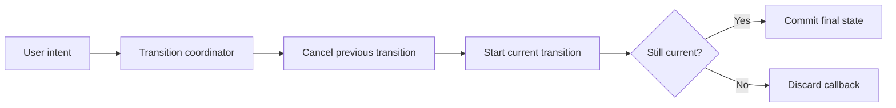

# Formatting example — fictional, not a real PR or measurement

English title (separate PR field): `fix(animation): cancel stale transitions on rapid toggles`

The following is a hypothetical illustration of style and structure. No code, tests, screenshots or benchmark results have been obtained. Do not submit it as a real PR.

---

## 📝 Summary

Prevent outdated animation completions from overriding newer interaction states when the user rapidly expands and collapses a desktop overlay. The proposed change gives the current transition exclusive ownership of its final state.

## 🔧 Changes

- **Transition ownership:** Associate each transition with an identifier and reject completion callbacks from superseded transitions.
- **Lifecycle:** Cancel active transitions before starting replacements and on component disposal.
- **Regression coverage:** Add a deterministic scenario for rapid reversal and stale callbacks.

## Architecture

The diagram illustrates the proposed control flow, not an inspected implementation.

## 🎨 Visual Evidence

Not captured. A real before/after recording of repeated expansion and collapse is required to verify the visible behavior.

## 🧪 Validation

| Check | Result | Scope |
| --- | --- | --- |
| Rapid reversal regression | NOT RUN | Proposed deterministic test |
| Component disposal | NOT RUN | Proposed lifecycle test |
| Desktop manual interaction | NOT RUN | Native Windows runtime required |

Frame pacing and resource usage have not been measured. No performance improvement is claimed.

## ⚠️ Compatibility & Risks

- Reduced-motion behavior and multi-monitor transitions remain unverified.
- Cancellation must preserve the current visual state to avoid discontinuities.

## Reviewer Notes

Inspect callback ownership and cancellation ordering, especially when a replacement transition is started before the previous callback completes.

---

## 中文摘要

本方案拟修复快速展开和收起桌面浮层时，旧动画回调覆盖最新交互状态的问题。

- 通过过渡标识、取消旧动画和回调有效性检查控制状态提交。
- 尚未运行回归测试或采集实际交互录屏，也未测量性能。
- 需验证动画取消的视觉连续性、减少动态效果设置及多显示器场景。
